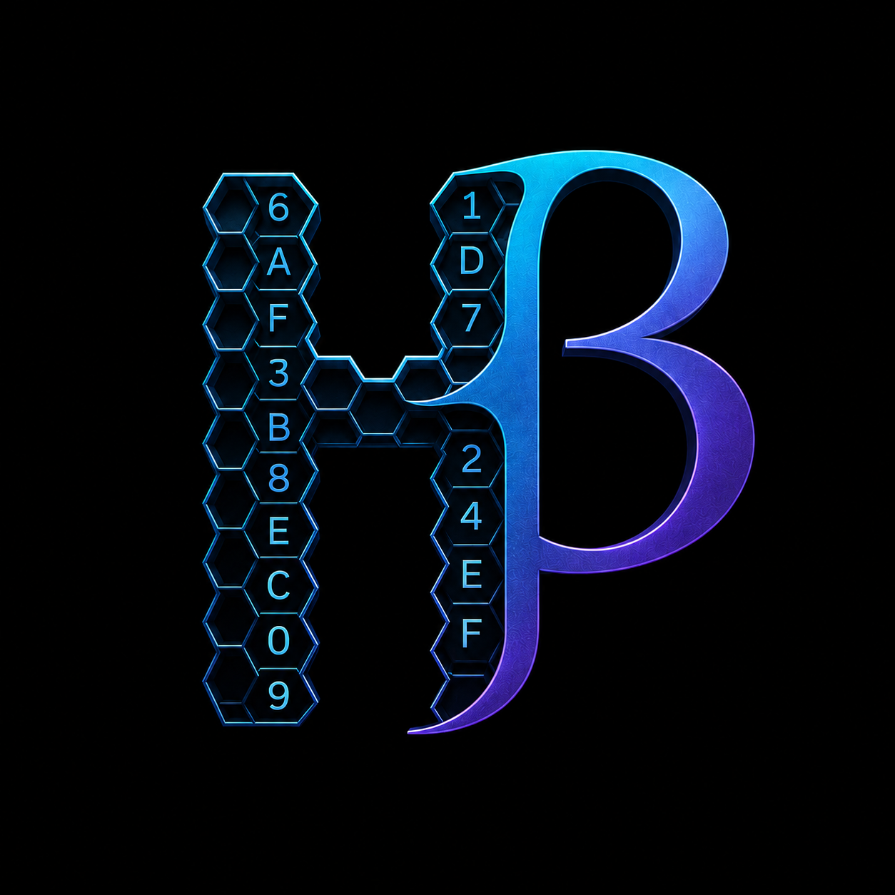

# BYTE PLUS
<p align="center">
</p>
> **Connect once. Build everywhere.**

DualBridge is an open-source communication framework that automatically bridges your backend with applications, AI agents, frontend frameworks, and services without writing repetitive integration code.

Instead of manually creating API wrappers, managing API keys, configuring WebSockets, writing authentication middleware, or maintaining multiple client SDKs, DualBridge handles the communication layer for you.

Whether you're using **FastAPI**, **Express.js**, an **MCP Server**, or any application that communicates through HTTP or WebSockets, DualBridge provides a secure and unified way to connect everything.

---

# Why?

Every backend project eventually needs the same things.

* REST API clients
* WebSocket connections
* Authentication
* API key management
* Secure communication
* Rate limiting
* Multiple language SDKs
* Configuration management

Developers spend hours writing infrastructure before they can build actual features.

DualBridge eliminates that repetitive work.

---

# Features

## 🌐 Multi-Framework Support

* FastAPI
* Express.js
* Future framework support through plugins

---

## 🔄 Built-in WebSocket Support

No additional WebSocket setup.

DualBridge automatically manages:

* Connection lifecycle
* Reconnection
* Event handling
* Message routing

---

## 🔑 API Key Management

Generate, store and manage API keys automatically.

Supports:

* Multiple keys
* Key rotation
* Expiration
* Permission levels

---

## 🔒 Optional Encryption

Security should be your choice.

Enable encryption for:

* API keys
* Stored credentials
* Configuration files

Or disable it for local development.

---

## 🛡 Password Protection

Secure your bridge with an additional password layer before any client is allowed to connect.

---

## 🚦 Rate Limiting

Protect your backend from abuse.

Configure:

* Requests per minute
* Concurrent connections
* WebSocket limits
* Custom policies

---

## 🧩 Automatic SDK Generation

Generate client libraries automatically.

Supported languages:

* Python
* JavaScript

Future releases will include additional languages.

---

## ⚡ One Configuration

Instead of writing boilerplate code, define your project once.

```yaml
backend: fastapi

endpoint: http://localhost:8000

sdk:
  - python
  - javascript

websocket: true

security:
  encryption: true
  password: my-password

rate_limit:
  requests_per_minute: 500
```

Then simply run

```bash
dualbridge connect
```

DualBridge automatically:

* Connects to your backend
* Generates SDKs
* Configures WebSockets
* Creates authentication
* Manages API keys
* Applies security settings

---

# Architecture

```
                    Backend
          (FastAPI / Express.js)
                     │
                     ▼
              ┌───────────────┐
              │  DualBridge   │
              └───────────────┘
          ┌────────┼─────────┐
          │        │         │
          ▼        ▼         ▼
     Python SDK  JavaScript  WebSocket
                     SDK

          │
          ▼

 AI Agents • MCP Servers • Web Apps
 Desktop Apps • Mobile Apps • CLI
```

---

# Example Use Cases

* AI Applications
* MCP Servers
* Internal APIs
* SaaS Platforms
* React Applications
* Next.js Applications
* Desktop Applications
* Mobile Applications
* Python Automation
* CLI Tools

---

# Philosophy

Infrastructure should not be rewritten for every project.

DualBridge allows developers to focus on business logic instead of repeatedly implementing communication layers, authentication systems, SDKs, and networking code.

Build your backend.

Configure DualBridge.

Connect everything.

---

# Roadmap

## Version 0.1

* [ ] FastAPI Support
* [ ] Express.js Support
* [ ] Configuration Parser
* [ ] CLI
* [ ] Python SDK Generator
* [ ] JavaScript SDK Generator

## Version 0.2

* [ ] WebSocket Manager
* [ ] API Key Manager
* [ ] Password Authentication
* [ ] Encryption

## Version 0.3

* [ ] Rate Limiting
* [ ] Plugin System
* [ ] Docker Support
* [ ] MCP Integration
* [ ] Additional Framework Support

---

# Contributing

Contributions of every size are welcome.

Whether you're fixing bugs, improving documentation, adding framework support, or proposing new features, your help makes DualBridge better for everyone.

---

# License

MIT License

---

> **Build your backend once. Connect it everywhere.**
